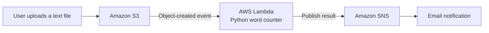

# Serverless File Processing and Notifications on AWS

## Project Overview

This project demonstrates an event-driven serverless workflow using Amazon Web Services (AWS). When a text file is uploaded to Amazon S3, an AWS Lambda function processes the file, counts its words, and uses Amazon SNS to send an email notification with the result.

The project also documents IAM permissions, testing procedures, monitoring, and troubleshooting.

**Project stage:** Portfolio documentation and implementation planning.

## Architecture



This diagram represents the intended design. Successful deployment and execution must be verified separately.

## AWS Services

| Service | Purpose |
|---|---|
| Amazon S3 | Stores uploaded text files |
| AWS Lambda | Processes files and counts words |
| Amazon SNS | Sends email notifications |
| AWS IAM | Controls access through roles and policies |
| Amazon CloudWatch | Provides logs for monitoring and troubleshooting |

## Workflow

1. A user uploads a text file to an S3 bucket.
2. An S3 object-created event invokes the Lambda function.
3. Lambda reads the object and counts its words.
4. Lambda publishes the result to an SNS topic.
5. SNS sends a notification to a confirmed email subscription.
6. CloudWatch logs help troubleshoot errors and verify execution.

## Security Considerations

- Use a dedicated Lambda execution role.
- Grant only the S3 read permissions and SNS publish permission required by the function.
- Restrict access to the S3 bucket and keep Block Public Access enabled.
- Store no credentials directly in the source code.
- Avoid logging file contents or other unnecessary sensitive information.
- Review resource permissions and expected AWS charges before deployment.

## Testing Plan

- Upload a text file containing a known number of words.
- Verify the Lambda invocation and word count.
- Confirm that the SNS notification contains the expected result.
- Test an empty file and a file with multiple lines.
- Review CloudWatch logs for failures.
- Verify that unauthorized access is denied.

Record actual test results in `docs/testing.md` after running the tests.

## Repository Structure

```text
aws-serverless-file-processing/
├── README.md
├── src/
│   └── lambda_function.py
└── docs/
    ├── architecture.md
    ├── iam-permissions.md
    ├── testing.md
    └── troubleshooting.md
```

## Learning Outcomes

This project is intended to demonstrate:

- Event-driven architecture
- Serverless application development with Python
- S3 event notifications
- IAM roles and least-privilege access
- SNS email notifications
- CloudWatch logging and troubleshooting
- Technical documentation and testing

## Project Status

The repository documents the intended architecture and implementation plan. AWS resources have not been confirmed as deployed or tested through this repository.

This is an educational portfolio project, not a claim of production readiness.

## Author

**Sabeeh Alvi**

- GitHub: https://github.com/sabeeh-alvi
