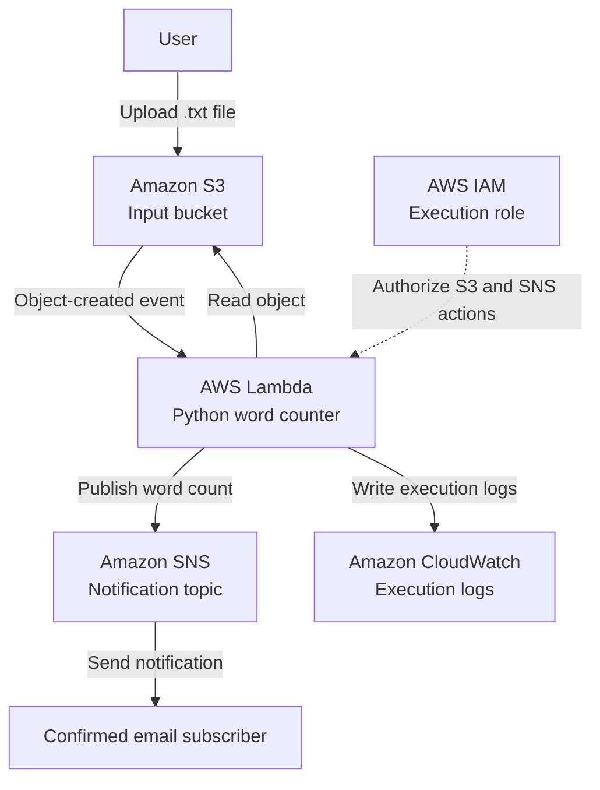

# Serverless File Processing Architecture

## Purpose

This document describes the intended event-driven workflow for processing text files with AWS managed services.

## Architecture Diagram

## Component Responsibilities

### Amazon S3

Stores the input text files and emits object-created events for the configured event notification.

### AWS Lambda

Receives the S3 event, reads the specified object, calculates the word count, and publishes the result to SNS.

### Amazon SNS

Distributes the processing result to subscribers. Email delivery requires a subscription that has been confirmed.

### AWS IAM

Provides the Lambda execution role and permissions needed to access the designated S3 objects, publish to the SNS topic, and write CloudWatch logs.

### Amazon CloudWatch

Stores Lambda execution logs that help verify processing and investigate errors.

## Event Flow

1. A text file is uploaded to the configured S3 bucket.
2. S3 invokes Lambda through an object-created notification.
3. Lambda retrieves the object and counts whitespace-separated words.
4. Lambda publishes a message containing the filename and word count to SNS.
5. SNS delivers the notification to confirmed subscribers.
6. CloudWatch records the Lambda execution logs.

## Security and Reliability

- Keep S3 Block Public Access enabled.
- Grant permissions only to the required bucket, objects, and SNS topic.
- Use a `.txt` suffix filter if appropriate, and ensure it does not conflict with other notifications for the same event type.
- Do not configure the Lambda function to create new triggering objects in the same input location.
- Consider duplicate event delivery and retry behavior when designing production workflows.
- Avoid logging sensitive file contents.

## Verification Status

This document describes the intended architecture. Successful deployment, event invocation, notification delivery, and security validation must be confirmed through testing before they are reported as completed.
